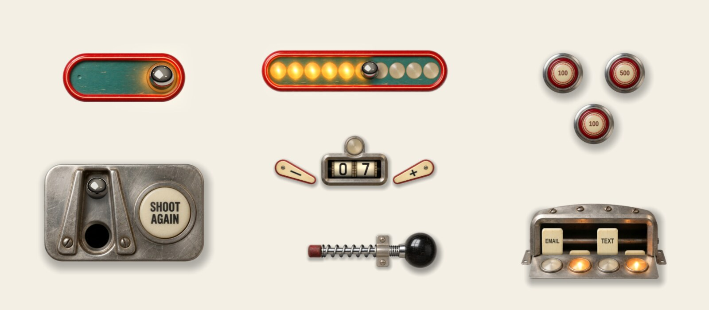

# Pinball UI

Seven ordinary interface controls rebuilt as pinball-machine parts. Each control is a standalone JavaScript file that registers a custom element, with its artwork and recorded sounds embedded inside it.



[](https://github.com/Brajesh31/pinmotion-ui/actions/workflows/validate.yml)
[](https://github.com/Brajesh31/pinmotion-ui/actions/workflows/deploy-pages.yml)
[](https://github.com/Brajesh31/pinmotion-ui/stargazers)

**[Open the live gallery](https://brajesh31.github.io/pinmotion-ui/gallery/)** · [Source code](https://github.com/Brajesh31/pinmotion-ui) · [Component registry](registry.json) · [LLM guide](llms.txt)

## 🎮 What is included

Pinball UI turns familiar interface patterns into tactile pinball mechanisms: a chrome ball rolls through a switch lane, lamps mark a slider's value, a shooter rod sends, score reels count, targets drop, an outhole provides undo, and pop bumpers score hits.

- **7 standalone JavaScript bundles** with no runtime package dependencies.
- **8 custom element tags**, because the bumper bundle defines both a single bumper and a three-bumper cluster.
- **Web Components** that can be used from plain HTML and JavaScript without a framework.
- **Keyboard and form support** for the value controls that expose form values.
- **Embedded artwork and recorded sound**, so each selected control is a single file to copy.

## 🧩 Components

| Control | Custom element(s) | Interaction | Live demo | Source and API docs |
| --- | --- | --- | --- | --- |
| Toggle | `<pinball-toggle>` | Switch with a rolling chrome-ball knob | [Demo](https://brajesh31.github.io/pinmotion-ui/toggle/) | [Source](toggle/toggle.js) · [Docs](toggle/README.md) |
| Slider | `<pinball-slider>` | Range slider with ten illuminated lamps | [Demo](https://brajesh31.github.io/pinmotion-ui/slider/) | [Source](slider/slider.js) · [Docs](slider/README.md) |
| Plunger | `<pinball-plunger>` | Pull-to-send button with a spring-loaded shooter | [Demo](https://brajesh31.github.io/pinmotion-ui/plunger/) | [Source](plunger/plunger.js) · [Docs](plunger/README.md) |
| Stepper | `<pinball-stepper>` | Number stepper with flippers and score reels | [Demo](https://brajesh31.github.io/pinmotion-ui/stepper/) | [Source](stepper/stepper.js) · [Docs](stepper/README.md) |
| Drop targets | `<pinball-targets>` | Checkbox group with up to four falling targets | [Demo](https://brajesh31.github.io/pinmotion-ui/targets/) | [Source](targets/targets.js) · [Docs](targets/README.md) |
| Drain | `<pinball-drain>` | Delete action with a timed undo window | [Demo](https://brajesh31.github.io/pinmotion-ui/drain/) | [Source](drain/drain.js) · [Docs](drain/README.md) |
| Pop bumpers | `<pinball-bumper>`, `<pinball-bumpers>` | Single hit button and a three-bumper scoring cluster | [Demo](https://brajesh31.github.io/pinmotion-ui/bumper/) | [Source](bumper/bumper.js) · [Docs](bumper/README.md) |

## 🚀 Add a control to your project

Choose only the control bundles your page needs. The files are deliberately distributed as plain scripts, not ES modules. Do not split a bundle: its photographs, sounds, and shared runtime data are embedded in the file.

### Option 1: Copy the standalone script

Copy the selected file into a folder served by your app. For example, copy `toggle/toggle.js` to `public/pinball-ui/toggle.js`, then load it from your page:

```html
<script defer src="/pinball-ui/toggle.js"></script>

<pinball-toggle name="notifications" label="Push alerts"></pinball-toggle>
```

Read the value and listen for changes:

```js
const toggle = document.querySelector('pinball-toggle');

toggle.addEventListener('change', (event) => {
  console.log('Push alerts enabled:', event.detail.checked);
});
```

### Option 2: Use the shadcn registry

The repository includes a `registry.json` with one file item for each bundle. In a project already configured for the shadcn CLI, add a component directly from this public GitHub registry:

```sh
npx shadcn@latest add Brajesh31/pinmotion-ui/toggle
```

Replace `toggle` with `slider`, `plunger`, `stepper`, `targets`, `drain`, or `bumper`. The registry targets files under `public/pinball-ui/`. Review the CLI output and generated file path in your own project before committing the change.

See the [shadcn CLI documentation](https://ui.shadcn.com/docs/cli) and the repository's [registry definition](registry.json).

### Important: this is not an npm package

The root `package.json` is a private developer-tooling manifest (`private: true`). There is no published `pinmotion-ui` npm package or supported `npm install pinmotion-ui` command at this stage. Use the standalone files or the registry route above.

## ⚙️ Shared configuration

### Size and page reflections

Set `--pb-size` to control a component's height. The live chrome ball uses `--pb-page` to match the page background; use a hex colour. The default page colour is the project's warm cream (`#f3efe5`).

```css
pinball-toggle {
  --pb-size: 42px;
  --pb-page: #f3efe5;
}
```

Each control has its own default dimensions. Check the individual component guide before overriding its size.

### Sound

Sound starts after the first user interaction, as browsers require. Add the `silent` attribute to mute one instance, or set the shared switch to mute every Pinball UI control on the page:

```html
<pinball-slider silent value="40" label="Volume"></pinball-slider>
```

```js
window.PinballKit.sound = false;
```

When several bundles are loaded on the same page, the first one establishes `window.PinballKit`; later bundles reuse the shared clock and WebGL context.

### Reduced motion and rendering requirements

- Most controls respect `prefers-reduced-motion` by skipping travel animations while keeping the final state and lamp feedback. **The Plunger is currently the exception**: its pull and shot animation still play.
- WebGL is required to draw the live chrome ball and lamps. Without WebGL, the controls remain focusable and usable, but those visual effects are not drawn.
- The photographed bodies keep a fixed shape rather than reflowing. They scale through `--pb-size` and remain sharp to roughly three times their default size.
- The bundles are relatively large because each contains its own artwork and sound data. Load only the controls a page actually uses.

## 🔌 Events and form integration

Use the element's properties and the documented events rather than reaching into its shadow DOM.

| Bundle | Main events | Event detail / value |
| --- | --- | --- |
| Toggle | `input`, `change` | `checked` boolean |
| Slider | `input`, `change` | `value` number |
| Plunger | `send` | `power` from `0` to `1` |
| Stepper | `input`, `change` | `value` number |
| Drop targets | `change`, `bonus` | Changed item, checked state, selected items, and all-checked state |
| Drain | `delete`, `undo`, `commit` | Delete lifecycle; `commit` means the undo window expired |
| Pop bumpers | `hit` | Hit index, points, count, score, and combo |

Toggle, Slider, Stepper, and Drop targets can participate in form submission when given a `name` attribute. Their keyboard behavior, attributes, properties, and methods are described in their individual guides.

## 🧪 Develop and validate

The repository tooling uses Node.js 22 or newer and npm 10 or newer. It has no third-party npm dependencies.

```sh
npm ci
npm run serve
```

Open `http://127.0.0.1:8000/gallery/` to use the local gallery. In another terminal, the main checks are:

```sh
npm run check
npm test
```

`npm run check` verifies generated bundle and documentation parity, then runs the repository validator. `npm test` runs the structural validator. The GitHub Actions validation workflow also installs from the lockfile, runs these checks, and smoke-tests the local static server.

### Browser interaction tests

The optional browser test drives the live gallery in headless Chrome or Chromium with touch and keyboard input, checks component events and form values, and checks for horizontal overflow at a phone-sized viewport. Start the local server first, then run:

```sh
npm run test:browser
```

Set `CHROME` to the Chrome or Chromium executable when it is not available as `chromium` on your `PATH`. The browser test is not part of the default `npm test` command.

### Useful developer commands

| Command | Purpose |
| --- | --- |
| `npm run serve` | Start the local static server on `127.0.0.1:8000` |
| `npm run build` | Regenerate standalone component bundles from the source and shared core |
| `npm run build:check` | Check generated bundles without writing changes |
| `npm run docs` | Regenerate component guides, demos, gallery, registry, and `llms.txt` |
| `npm run docs:check` | Check generated documentation and registry parity |
| `npm run validate` | Run read-only repository structure and metadata checks |
| `npm run screenshots -- <url> <output-prefix> <width> <height> <scale>` | Capture a page using headless Chrome or Chromium |

## 📚 Project documentation

- [Live interactive gallery](https://brajesh31.github.io/pinmotion-ui/gallery/)
- [Component guides](toggle/README.md), with per-component API, attributes, events, sizing, and known limits
- [Registry definition](registry.json), for shadcn CLI installation
- [LLM reference](llms.txt), a compact machine-readable project guide
- [Pinball UI skill](skills/pinball-ui/SKILL.md), the workflow for integrating or creating controls in this style
- [How it was made](making-of/README.md), including design decisions, artwork plates, WebGL rendering, and sound

## 🧭 Browser and accessibility status

The repository's interaction tests exercise headless Chromium with touch and keyboard input at a mobile viewport. The project documentation does **not** claim that Safari, Firefox, physical phones, or screen-reader behavior has been tested. Sound playback has also not been verified on a physical phone. Treat those as open validation areas, not supported-browser guarantees.

## 📄 License status

No root `LICENSE` file is currently present, and the private developer package declares `UNLICENSED`. An earlier generated reference incorrectly described the project as MIT licensed; that claim is being removed until an explicit license is added. Do not assume that the source is available for redistribution under MIT or another open-source license.

## 👤 Maintainer

Brajesh Kumar · [GitHub](https://github.com/Brajesh31)

---

Built to make familiar controls feel like they belong on a pinball playfield.