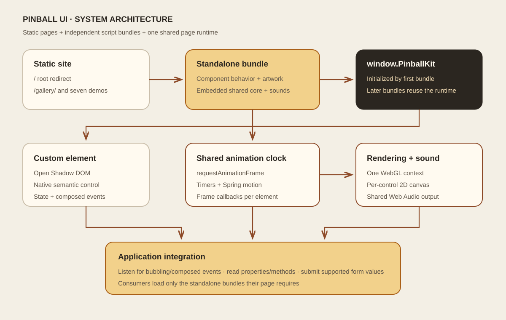

# 🏛️ System architecture

## 1. Overview

Pinball UI is a static collection of 29 standalone Web Component bundles. It does not ship a framework application, server API, or client-side router. Seven original controls use a shared WebGL/audio runtime; 22 utility controls use a compact CSS/native base. The published site consists of static HTML pages, generated component demos, JavaScript bundles, and a component registry.

The implementation has four cooperating layers:

1. **Page layer:** the gallery and individual demo pages provide the document structure, layout, descriptions, and links.
2. **Component layer:** each component bundle defines its custom element, internal state, input behavior, animation, and public events.
3. **Mechanical runtime layer:** the original seven bundles expose `window.PinballKit`, a shared frame clock, spring helper, WebGL renderer, sound system, and a custom-element base class.
4. **Utility runtime layer:** the 22 new bundles embed `tools/extra-core.js` as `window.PinmotionExtras`, a small base for Shadow DOM, events, disabled state, form values and shared CSS tokens.
5. **Embedded asset layer:** only the original mechanical bundles embed source artwork and recorded sound data.

The design intentionally trades bundle size for simple distribution. A consumer copies one script and does not need to separately install the artwork, sound files, core runtime, or a package dependency.

## 2. Source and generated artifact model

| Path | Role |
| --- | --- |
| `core.js` | Shared runtime source. The sound-data marker is filled during the build. |
| `{component}/{component}.js` | Distributed bundle and location of component-specific behavior. Embedded art and core sections are refreshed by the build script. |
| `art/{component}/` | Source WebP plates used by a component. |
| `sounds/` | Source recorded sound takes embedded into each bundle. |
| `tools/build.mjs` | Embeds PinballKit/core/art in the original seven; concatenates `tools/extra-core.js` and `extras-src/{id}.js` for the 22 utility bundles. |
| `tools/spec.mjs` / `tools/extras-spec.mjs` | Canonical metadata for the original seven and 22 utility components. |
| `tools/docs.mjs` | Generates component READMEs, component demo pages, the gallery, registry, and `llms.txt`. |

A key distinction: the downloadable component bundle is not just a minified build product. It also contains the component-specific class and behavior. The build tool updates the named embedded sections while preserving the component implementation outside those sections. There is no separate `src/components/` directory in the current repository.

## 3. Standalone bundles and shared runtime initialization

Each of the original seven mechanical files embeds a copy of the PinballKit core. That core exits early when `window.PinballKit` already exists. The 22 utility files embed `tools/extra-core.js` plus one `extras-src/{id}.js` source and guard against duplicate `window.PinmotionExtras` initialization.

- On a page that loads one bundle, that bundle initializes the runtime and defines its element.
- On a page that loads several bundles, the first one initializes the runtime. The later embedded core copies return without creating another shared runtime, then the remaining component-specific code continues and registers its element.
- All components on that page share the runtime's frame clock, animation state, WebGL context, and sound controller.

The gallery can load all seven mechanical bundles while using one shared renderer and audio controller. Utility bundles share their separate lightweight base. Each distributed bundle can be copied independently.

## 4. Custom-element lifecycle

The shared `PinballKit.Base` class provides common lifecycle behavior for controls that extend it.

### Construction and connection

1. The constructor attaches an **open Shadow DOM** root with delegated focus.
2. It attempts to attach `ElementInternals` when the component declares itself form-associated. The implementation catches attachment failures.
3. On the first connection, the base writes the component's internal style and markup, calls `setup()`, and synchronizes any form value.
4. A `ResizeObserver` marks the component dirty and starts the shared animation loop when its dimensions change.
5. A `MutationObserver` watches the `disabled` attribute and makes the host inert while disabled.
6. The component's frame callback is registered with the shared clock.
7. On disconnection, that callback is removed from the active frame set.

The base provides `render()`, `setup()`, and `frame()` hooks, a shadow-root query helper, form synchronization, a sound accessor, and an event emitter.

### Events across the Shadow DOM boundary

The base emits `CustomEvent` instances with `bubbles: true` and `composed: true`. Consumers can therefore listen on the custom element or an ancestor outside its shadow root. Public event contracts are summarized in the [component reference](component-reference.md).

## 5. Animation clock and physics helpers

The runtime uses one `requestAnimationFrame` loop for active controls. Component frame callbacks are stored in a shared set. Timed callbacks are stored against the runtime's logical clock and executed during an advance step.

The loop:
- clamps each observed frame delta to a maximum of 34 milliseconds;
- advances logical time by the delta multiplied by `PinballKit.rate`;
- runs due timers;
- calls each active component's `frame(dt)`;
- updates the rolling-sound level;
- stops requesting frames when no component is active and no timer remains, unless the runtime is paused.

The `Spring` helper integrates a damped spring in small substeps. It exposes `step(dt)`, `idle`, and `snap(x)`. The shared `feel` values tune the ball's kick, pull, drag, bounce, rocking, and settling behavior.

Animation can be stepped manually with `PinballKit.advance(dt)`, which is useful for deterministic film or capture workflows. `PinballKit.paused` and `PinballKit.rate` control the shared loop.

## 6. Rendering pipeline

The core lazily creates one offscreen WebGL canvas and requests a WebGL 1 context. Each control supplies its own fragment shader and scene description. The shared ball shader calculates reflections and shadows over that scene.

The renderer:
1. compiles a shared vertex shader and component fragment shader;
2. loads an artwork plate as a WebGL texture;
3. pads the image to power-of-two dimensions before generating mipmaps;
4. renders a full-canvas pass into the shared WebGL canvas;
5. copies the relevant rendered area into the control's own 2D canvas.

The chrome ball is rendered as a mirror. It reflects a simplified room above the horizon and the artwork or page colour below it. Scratches and smudges rotate with the ball. The control's plate remains the static body while the live shader supplies moving elements, lamps, shadows, and reflections.

WebGL is required for the ball and lamps. When WebGL is unavailable, the project documentation says the control remains focusable and usable, but the shader-drawn appearance is missing. This is a known visual degradation path, not a fully equivalent fallback renderer.

## 7. Sound pipeline

The runtime uses the Web Audio API, with an AudioContext fallback for `webkitAudioContext`. It creates a gain/compressor output path and decodes embedded audio buffers after the first pointer or keyboard interaction.

The recorded takes are selected with variation so that the same take is not played twice consecutively when alternatives exist. Playback rate and gain can vary by effect. The rolling sound is looped and its gain, playback rate, and filter follow the current ball speed.

The shared sound API includes kick, clack, tock, relay, chime, and roll effects. Set the instance's `silent` attribute to suppress its sound, or set `PinballKit.sound = false` to mute the shared output.

## 8. Runtime globals

The original mechanical family exposes `window.PinballKit`. The utility family exposes `window.PinmotionExtras`. Both are low-level implementation surfaces; documented component APIs remain the consumer-facing contract.

| Member | Purpose |
| --- | --- |
| `paused`, `rate` | Pause or scale the shared logical animation clock |
| `sound`, `voice`, `chimes`, `level` | Shared sound enablement, voice mode, chime enablement, and master level |
| `trace`, `heard` | Sound tracing switch and collected sound trace records |
| `feel` | Shared ball-motion tuning values |
| `calm`, `now` | Read-only reduced-motion state and logical clock time |
| `advance`, `later`, `start` | Clock and timed-callback operations |
| `Spring`, `clamp`, `lerp`, `TAU` | Shared math and motion helpers |
| `getGL`, `program`, `texture`, `paint`, `glsl` | WebGL and shader helpers |
| `sfx`, `audio`, `Base`, `define`, `asset` | Sound, component base, registration, and asset URL helpers |

This global is not a separately versioned package API. Prefer the documented custom-element properties, attributes, and events in application code. Treat lower-level members as implementation or creative-tooling interfaces that can evolve with the repository.

## 9. Lightweight utility runtime

The 22 utility bundles are assembled from `tools/extra-core.js` and `extras-src/{id}.js`. The base attaches an open Shadow DOM root, injects a shared CSS system, calls the component setup hook, observes the host `disabled` attribute and sets `inert`, and dispatches composed bubbling custom events. Where a component declares itself form-associated, it attempts `ElementInternals` and updates its form value through `syncForm()`.

Unlike PinballKit, the utility base has no frame clock, WebGL context, shader pipeline, recorded audio or embedded photographs. It provides compact native/CSS controls that share the project's visual direction without the heavy renderer.

## 10. Architecture diagram

Editable sources: [Mermaid diagram](diagrams/system-architecture.mmd).
