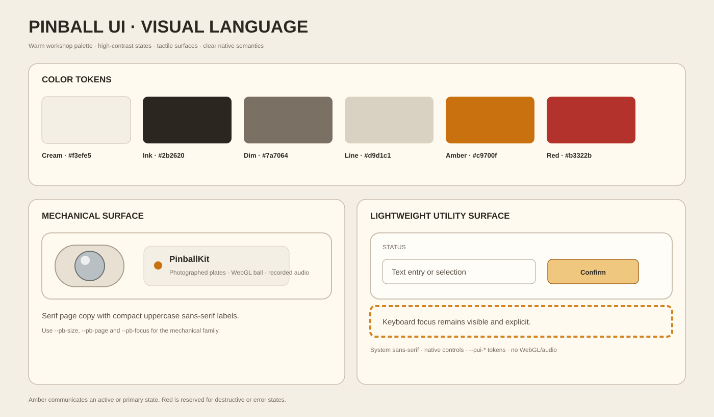

# 🎨 Pinball UI design system

The library has one mechanical visual direction and two rendering families. Both use a warm workshop palette, brushed-steel bezels, dark playfield wells, chrome fasteners/ball details, amber lamps and brass control surfaces. The original seven controls achieve this with photographed plates and live WebGL rendering; the 22 utility components preserve native browser semantics inside CSS-rendered pinball control decks.

## 1. Design principles

1. **Mechanical character, clear interaction.** Controls can feel tactile, but their state, label, keyboard model and event contract must remain explicit.
2. **Native semantics first.** Use native inputs, buttons, links, details/summary, dialog and form APIs when they fit the control.
3. **One shared palette, two runtimes.** Keep the visual identity consistent without loading the heavy PinballKit renderer into lightweight components.
4. **Self-contained delivery.** A consumer loads one standalone script for the component they need. Do not require a separate CSS file, external image host or third-party runtime package.
5. **Honest capability claims.** A visual metaphor does not guarantee screen-reader support, cross-browser behavior, WebGL fallback or reduced-motion completeness. Document tested behavior and known gaps.

## 2. Runtime families

| Family | Components | Rendering and shared runtime | Visual treatment |
| --- | --- | --- | --- |
| Original mechanical | Toggle, Slider, Plunger, Stepper, Drop Targets, Drain, Pop Bumpers | PinballKit, WebGL, source WebP plates, embedded recorded audio | Photographed machine bodies, chrome-ball reflections, lamps, springs and physical impacts |
| Lightweight utility | Checkbox, Radio Group, Segmented Control, Progress, Meter, Rating, Tabs, Accordion, Disclosure, Tooltip, Dialog, Toast, Breadcrumbs, Pagination, Search, Text Field, Text Area, Select, Combobox, File Drop, Date Picker, Color Picker | PinmotionExtras, native HTML semantics and CSS; no WebGL or recorded audio | Brushed-steel control decks, chrome fasteners, amber lamps, brass buttons, inset playfield wells and native inputs |

Do not add `window.PinballKit`, shader code or recorded sound payloads to a utility component merely to reuse the color language. Do not assume PinballKit APIs exist when a utility bundle is loaded by itself.

## 3. Color tokens

| Purpose | Mechanical pages | Lightweight utility controls |
| --- | --- | --- |
| Surface | `--bg: #f3efe5` | `--pui-bg: #f7f2e8` |
| Main text | `--ink: #2b2620` | `--pui-ink: #28231d` |
| Secondary text | `--dim: #7a7064` | `--pui-dim: #776e62` |
| Border | `--line: #d9d1c1` | `--pui-line: #c9bead` |
| Action accent | `--amber: #c9700f` | `--pui-amber: #c9700f` |
| Destructive accent | `--red: #b3322b` | `--pui-red: #b3322b` |
| Focus | `--pb-focus`, default `#e8961e` | `--pui-focus: #d18420` |

The two surfaces are intentionally close, not identical. Change both token sets together when making a brand-level palette adjustment. Do not recolor the photographs or assume CSS tokens recolor embedded image plates.

## 4. Typography

**Mechanical site pages** use a Georgia/Iowan Old Style/Times serif stack for main copy, with compact uppercase labels in Futura/Century Gothic/Avenir Next/Trebuchet fallbacks. **Utility controls** use a system sans-serif stack for familiar form readability.

Use concise labels. Keep utility control labels and option text easy to scan. The physical target and bumper plates have limited space, so the component APIs document short text limits.

## 5. Shape, spacing and elevation

- Mechanical plates retain their photographed aspect ratios. Size is controlled by `--pb-size` and does not cause the machine body to reflow.
- Utility controls use compact bordered panels, generally 8–14px corner radii, steel borders, inset highlights and restrained shadows.
- Amber is for active/selected/primary states. Red is reserved for destructive or error states.
- Prefer a visible outline on keyboard focus. Do not remove focus styling to achieve a flatter screenshot.
- Use flexible wrapping rows and grids so form controls can fit narrow containers.

## 6. Interaction states

| State | Expected treatment |
| --- | --- |
| Default | Neutral cream surface and steel border |
| Hover | Subtle background or border response; not the only way to expose information |
| Focus-visible | Clear outline using the family focus token |
| Active / selected | Amber lamp, inset or raised control surface with a semantic state attribute |
| Disabled | Inert or native disabled behavior, reduced contrast, and no user action |
| Error | Red border/accent plus a visible message where a validation error exists |
| Success | Green or amber feedback only when the status is genuinely meaningful |

The shared utility base applies `inert` to a disabled host. Native controls also keep their own disabled, required and constraint semantics where implemented.

## 7. Motion and sound

- PinballKit controls use a shared animation clock, WebGL and recorded audio. Most controls honor `prefers-reduced-motion`; Plunger is the current exception.
- Drop Targets' `bonus` event is tied to the normal-motion impact callback. Use the `change` event's `allChecked` state for application logic when reduced motion is enabled.
- Utility controls use native browser interaction and short CSS transitions. Progress indeterminate mode currently animates its stripe; it does not yet define a dedicated reduced-motion override.
- Sound is supplemental feedback, not an application state signal. Only the original mechanical runtime exposes PinballKit shared audio controls.

## 8. Accessibility rules

- Use a visible or programmatic accessible name for every interactive element.
- Prefer native elements when their behavior matches the control.
- Keep keyboard support equivalent to the pointer path.
- Expose selected, expanded, current and disabled state with native attributes or ARIA where needed.
- Do not use color alone to communicate checked, error, success or current-page state.
- Respect form validation and form value semantics. Test `ElementInternals` support in the consuming browser.
- Do not describe the library as screen-reader certified. The repository does not contain a completed assistive-technology audit.

## 9. Source-of-truth files

| Concern | Source |
| --- | --- |
| Mechanical page CSS | `tools/docs.mjs`, `PAGE` style template |
| PinballKit rendering and runtime | `core.js` |
| Utility base CSS and lifecycle | `tools/extra-core.js` |
| Mechanical component metadata | `tools/spec.mjs` |
| Utility component metadata | `tools/extras-spec.mjs` |
| Mechanical behavior | `{id}/{id}.js`, outside build markers |
| Utility behavior | `extras-src/{id}.js` |

## 10. Visual references

- [Component family map](visuals/component-families.svg)
- [Visual language and token board](visuals/visual-language.svg)
- [Editable component-family diagram](diagrams/component-families.mmd)

Utility controls can reuse recorded PinballKit sound effects when the mechanical runtime is already present on the page. They do not load that runtime or audio by themselves. Use these diagrams as documentation assets. They are not a substitute for testing an individual component in the actual browser.
